# Reloj de Mesa KOR

[](https://github.com/ivankorzy25/reloj-de-mesa-kor/releases/latest/download/RelojDeMesaKOR.apk)
[](https://github.com/ivankorzy25/reloj-de-mesa-kor/releases)


**El StandBy del iPhone, en tu Android.** Dejás el teléfono cargando acostado de costado y aparece un reloj grande sobre la pantalla de bloqueo. Lo levantás y desaparece solo. Gratis, sin publicidad, sin cuentas.

[🇬🇧 English](README.en.md)

## 📲 Descargar e instalar (sin saber nada)

1. Desde el teléfono, bajá **[RelojDeMesaKOR.apk](https://github.com/ivankorzy25/reloj-de-mesa-kor/releases/latest/download/RelojDeMesaKOR.apk)**.
2. Tocá el archivo descargado. Si Android pregunta, permití *instalar apps desconocidas* para el navegador (es un APK fuera de Google Play; el código es abierto y está acá).
3. Abrí la app: la guía de la primera vez te lleva de la mano por los permisos, un paso por pantalla.
4. Enchufalo y acostalo de costado. Listo.

Probado en Samsung Galaxy S25 Ultra (One UI). Anda en cualquier Android 12 o más nuevo.

## 📸 Así se ve

**Ocho caras de reloj**, que se pasan con el dedo:

| Digital | Cuadrícula | Flotante | Solar |
|---|---|---|---|
| 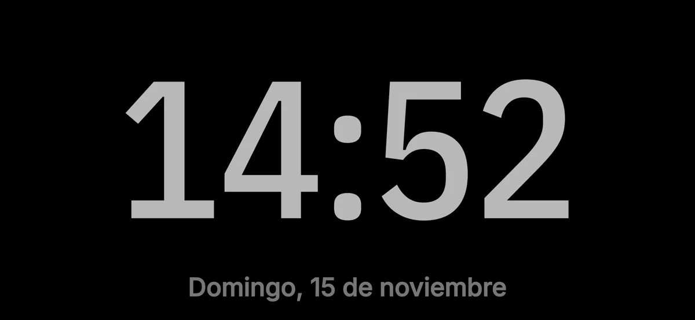 | 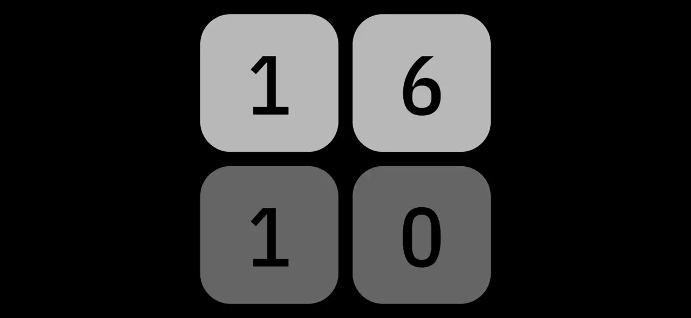 | 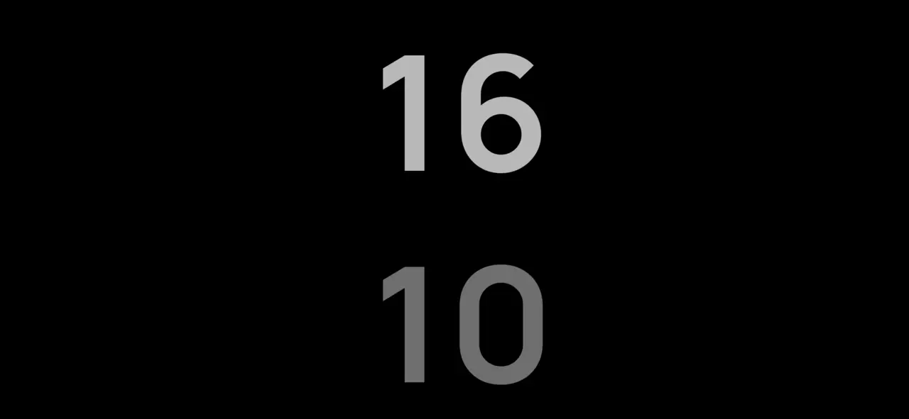 | 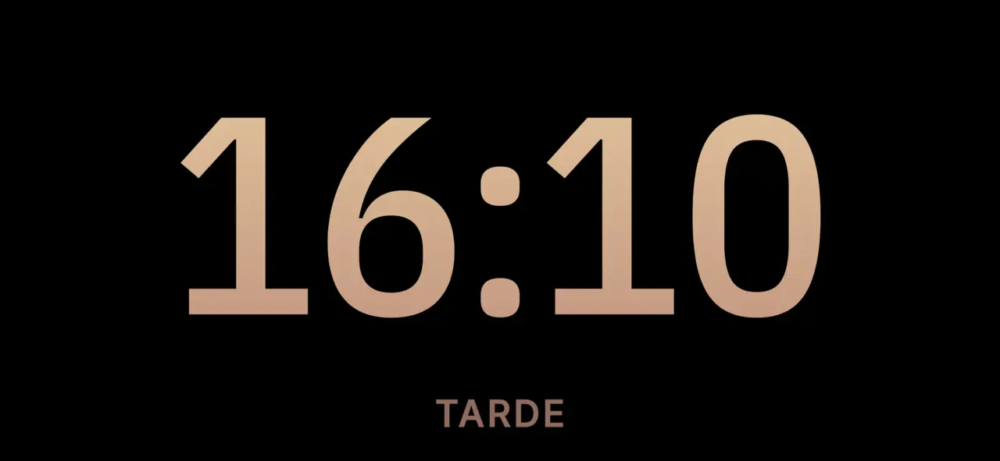 |

| Analógico | Flip clock | Reloj mundial |
|---|---|---|
| 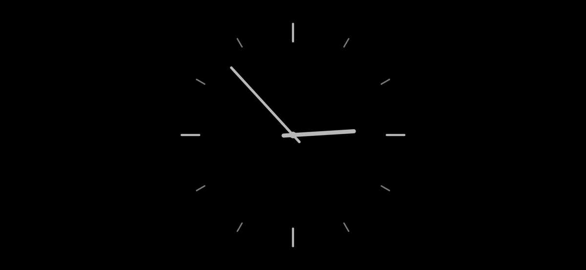 | 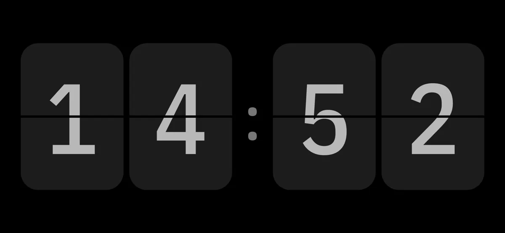 | 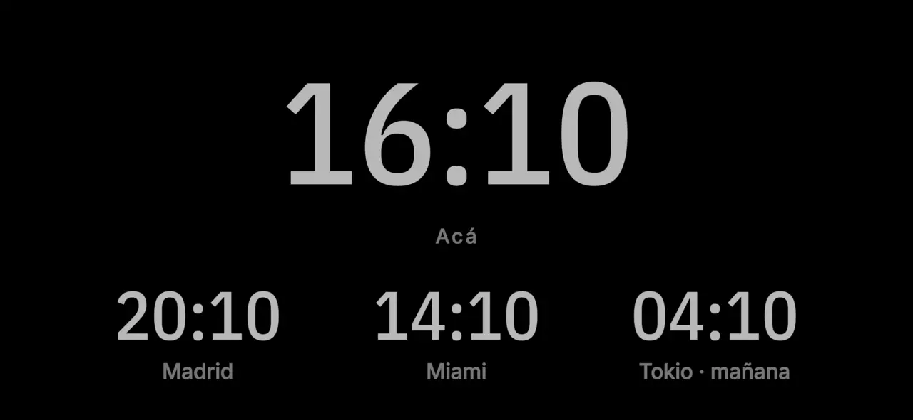 |

**Con tarjeta al costado** — clima, agenda, alarma y batería, lo que está sonando:

| Clima | Alarma y batería | Reproduciendo |
|---|---|---|
| 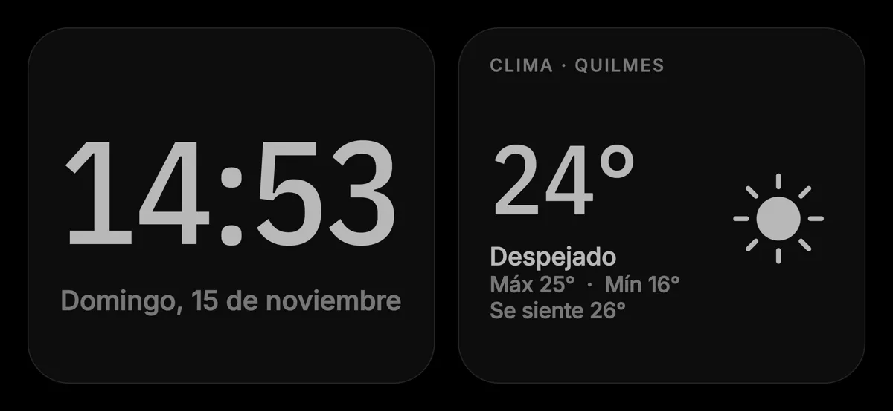 | 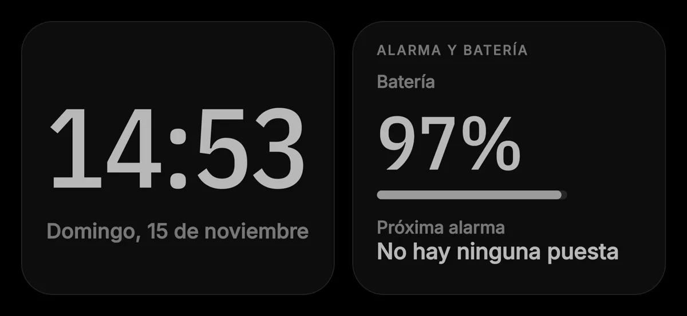 | 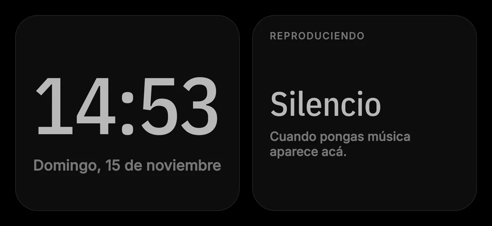 |

**Dos columnas de tarjetas**, cada una con su propio dedo:

| Reloj + clima | Clima + batería |
|---|---|
| 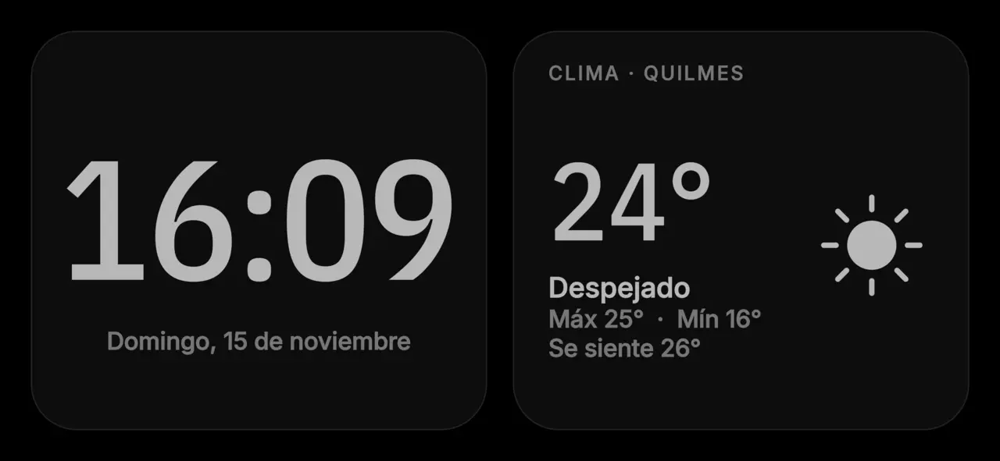 | 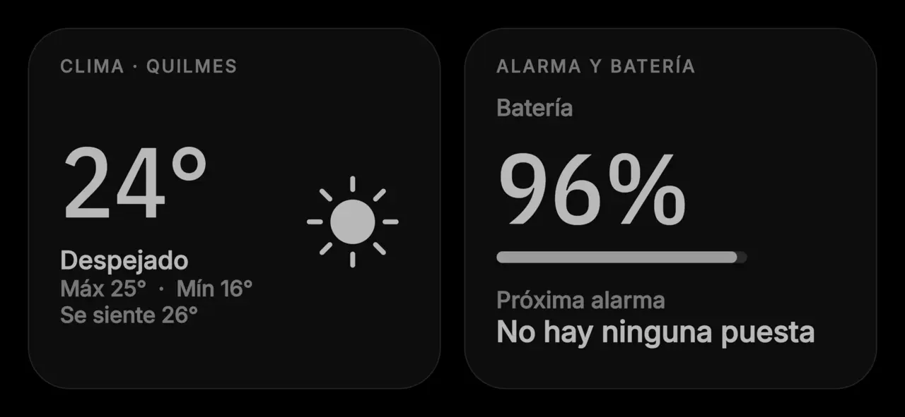 |

**Lo que está pasando ahora**, a toda la pantalla, y la pantalla atenuada de la madrugada:

| Llamada entrante | Temporizador | Siempre encendido |
|---|---|---|
| 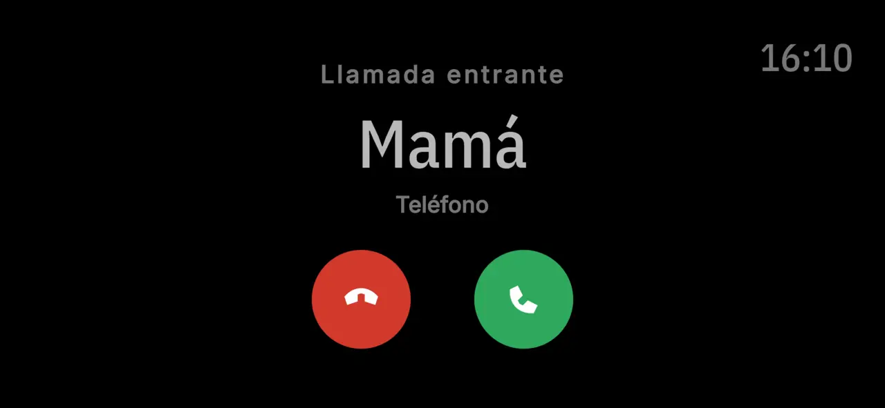 | 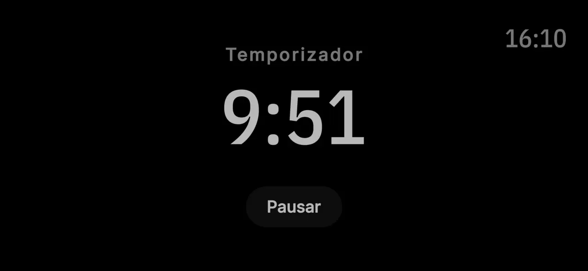 |  |

**Colores y tipografías** a gusto:

| Ámbar | Celeste | Lila |
|---|---|---|
| 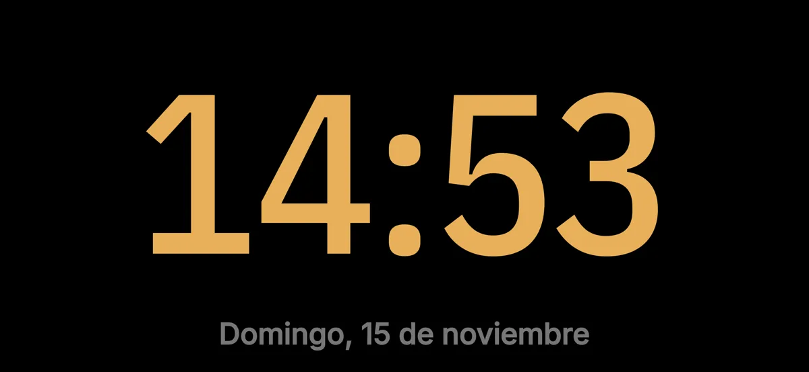 | 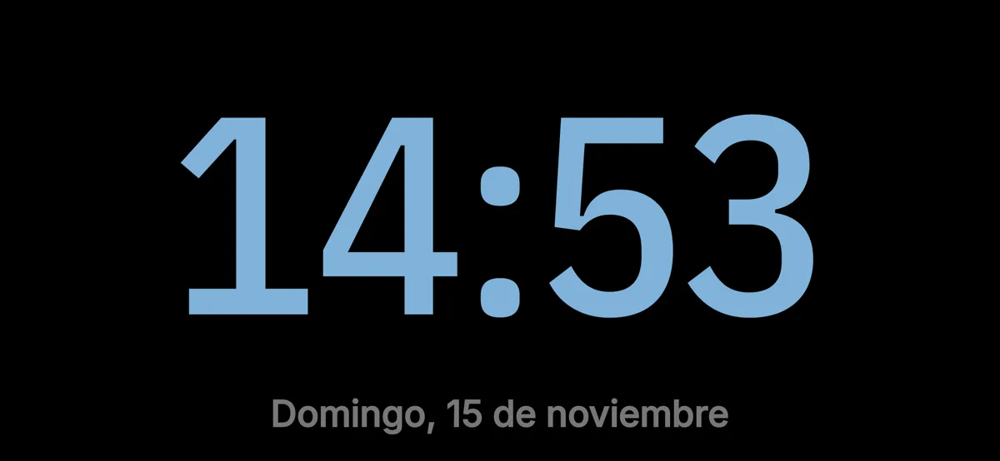 | 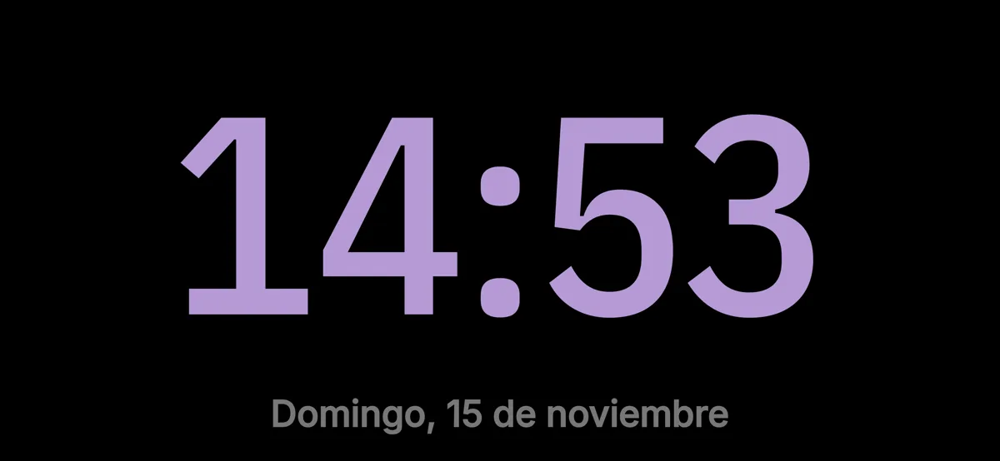 |

| Redonda gruesa | Geométrica | Monoespaciada |
|---|---|---|
| 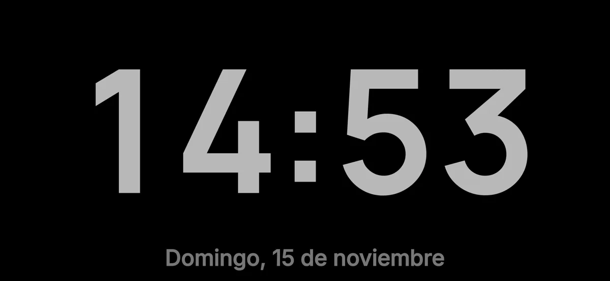 | 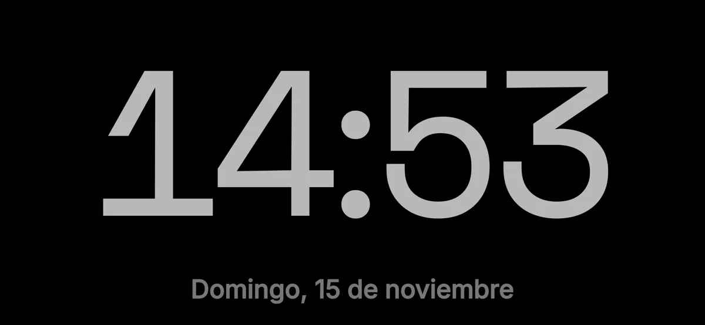 | 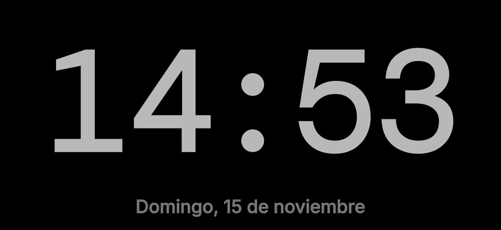 |

**Modo noche**, rojo tenue para no encandilar:

| Digital | Con tarjeta |
|---|---|
| 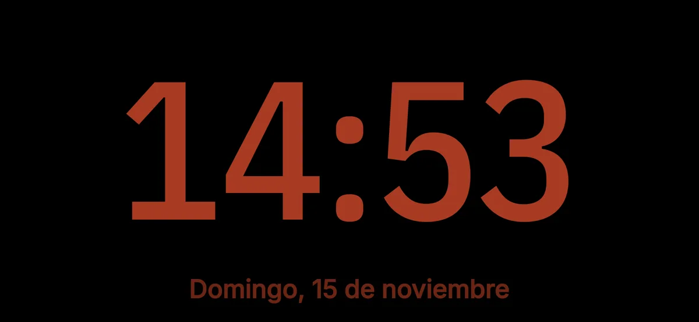 | 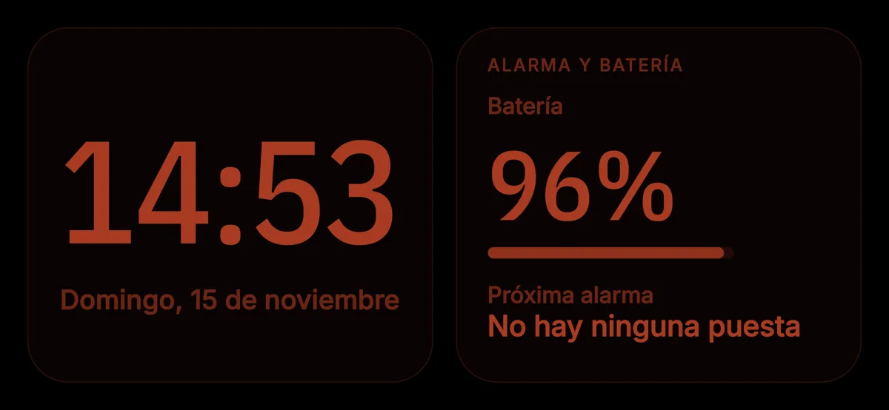 |

Todas las variantes están en [`docs/capturas`](docs/capturas) a resolución completa.

## Qué hace

- **Aparece solo.** Se apagó la pantalla y el teléfono está apoyado sobre el lado largo:
  el reloj se pone por encima del bloqueo. Acostado boca arriba, o mientras lo estás usando,
  no aparece.
- **Ocho caras de reloj**, que se pasan con el dedo de izquierda a derecha y se recuerdan:
  - **Digital**, con tipografía condensada fina a todo el ancho y dígitos de un solo ancho.
  - **Cuadrícula**: cada dígito en su celda de color pleno, para ver la hora de lejos.
  - **Flotante**: la hora arriba y los minutos abajo, en redonda bien gorda.
  - **Solar**: los números se pintan con el color del momento del día (madrugada, amanecer,
    mediodía, tarde, atardecer, anochecer).
  - **Analógica** minimalista, sin números.
  - **Flip clock**, con el giro de ficha de los carteles viejos.
  - **Reloj mundial**: la hora de acá y la de hasta tres ciudades, con el aviso de si allá ya
    es mañana.
  - **Fotos**: carrusel de tu Immich con la hora en una esquina, con movimiento suave de
    cámara y, si querés, solo las fotos del mismo día de otros años ("recuerdos").
- **Tarjetas al costado**, que se pasan con el dedo de arriba a abajo. Podés tener una sola al
  lado del reloj, o **dos columnas de tarjetas** con el reloj como una tarjeta más:
  - **Clima** de [Open-Meteo](https://open-meteo.com) (sin clave ni cuenta), del lugar que elijas.
  - **Agenda**: los próximos eventos del calendario del teléfono.
  - **Alarma y batería**: la próxima alarma del sistema y cuánta carga queda.
  - **Próxima alarma** bien grande, con el día y cuánto falta.
  - **Reproduciendo**: carátula, título y play/pausa de lo que esté sonando.
  - **Widget del sistema**: cualquier widget de escritorio, con los bordes desvanecidos.
- **Lo que está pasando, a toda la pantalla.** Si te llaman, el nombre ocupa toda la pantalla
  con los botones de atender y colgar; si tenés un temporizador corriendo, se ve la cuenta
  atrás con sus botones; si hay música, la carátula grande con los controles. Se puede apagar.
- **Siempre encendido.** Después de unos minutos sin tocar nada, y solo si está cargando, la
  pantalla baja al mínimo y queda la hora chiquita, que se corre de lugar para no quemar el
  OLED. Un toque la vuelve a encender (y no cierra el reloj).
- **Se acuerda de cada lugar.** La mesa de luz y el escritorio casi nunca tienen el mismo
  cargador: el reloj reconoce en cuál está y vuelve a poner la cara y las tarjetas que habían
  quedado ahí. Sin pedir ubicación ni ningún permiso nuevo.
- **Avisos estilo iPhone.** Las notificaciones nuevas aparecen arriba en una burbuja grande,
  se van solas a los 8 segundos, se tocan para abrir la app y se deslizan para arriba para
  sacarlas. Se elige de qué apps se muestran, y el texto se tapa con las mismas reglas que
  usa la pantalla de bloqueo.
- **Modo noche.** De noche (por horario, y si querés también cuando el sensor ve el cuarto a
  oscuras) todo pasa a rojo tenue y el brillo no supera el 25 %.
- **Personalización.** Color del reloj, cuatro tipografías, tamaño, segundos y 12/24 horas,
  con previsualización en vivo en Ajustes.
- **Sin publicidad, sin cuentas y sin telemetría.** Solo sale a internet para el clima y,
  si la configurás, para tus fotos de Immich.
- **Brillo automático** según la luz del ambiente, suave, sin saltos.
- **Guía de la primera vez** en criollo, un paso por pantalla, para dejarlo andando sin saber
  nada de Android.

## Compilarlo vos mismo

El APK firmado se arma con Gradle y se instala a mano (no está en Google Play):

```bash
./gradlew assembleRelease           # queda en app/build/outputs/apk/release/
adb install -r app/build/outputs/apk/release/app-release.apk
```

Para que el release salga firmado hay que dejar un `keystore.properties` en la raíz (está en
`.gitignore`):

```properties
storeFile=/ruta/a/tu.keystore
storePassword=...
keyAlias=...
keyPassword=...
```

La primera vez, la app abre sola la guía de permisos. Los que hacen falta son: aparecer sobre
otras apps, batería sin restricciones, la notificación del servicio, acceso a notificaciones
y el protector de pantalla de Samsung apagado.

## Fotos de Immich

En Ajustes → Fotos de Immich se pone la dirección del servidor y una clave de API (Immich →
Cuenta → Claves de API), con botón para probar la conexión. La clave queda solo en el
teléfono.

Para no tipearla en la pantalla chica, también se puede empujar por adb y la app la toma en
el próximo arranque (y después borra el archivo):

```bash
printf 'url=https://tu-immich\nkey=TU_CLAVE\n' > immich.txt
adb push immich.txt /sdcard/Android/data/ar.kor.reloj/files/immich.txt
```

## Probar el modo sin tocar el teléfono

```bash
adb shell am broadcast -a com.realfamousbae.standby.dock.SHOW_NOW -p ar.kor.reloj
adb shell am broadcast -a com.realfamousbae.standby.dock.HIDE_NOW -p ar.kor.reloj
# fijar la configuración desde adb (para demos y capturas):
adb shell am broadcast -a com.realfamousbae.standby.dock.DEMO -p ar.kor.reloj \
  --es face Flip --es layout ClockAndWidget --es card Clima --es color FFE8B059 --es font Redonda --es night 0
```

Extras aceptados:

| Qué | Valores |
|---|---|
| `face` | Digital, Cuadricula, Flotante, Solar, Analogico, Flip, Mundial, Fotos |
| `layout` | ClockOnly, ClockAndWidget, Widgets |
| `card`, `card2` | Reloj, Clima, Calendario, AlarmaBateria, AlarmaGrande, Musica, Widget |
| `cities` | nombres separados por coma: `"Madrid,Miami,Tokio"` |
| `color` | ARGB en hexa, por ejemplo `FFE8B059` |
| `font` | CondensadaFina, Redonda, Geometrica, Mono |
| `size`, `seconds`, `hour` | tamaño en %, 0/1, y Sistema / H24 / H12 |
| `night`, `nightsensor`, `nightstart`, `nightend` | 0/1 y minutos desde las 00:00 |
| `live` | llamada, timer, musica, off — arma una actividad en vivo de mentira para las fotos |
| `dim`, `dimminutes`, `dimnow` | el "siempre encendido": prenderlo, a los cuántos minutos, y forzarlo ya |
| `memories`, `favorites` | las fotos: recuerdos del mismo día, y solo las favoritas |
| `charging`, `places` | pedir cargador para aparecer, y la memoria por lugar |
| `on` | 1 o 0: prender o apagar el reloj (sirve después de un "forzar detención") |
| `dump` | devuelve el registro de diagnóstico como resultado del broadcast |

Está protegido con el permiso DUMP, que solo tienen adb y el sistema.

En los Samsung, `logcat` no muestra lo que escriben las apps de uno; por eso el `dump` del
comando contesta por el propio broadcast:

```bash
adb shell am broadcast -a com.realfamousbae.standby.dock.DEMO -p ar.kor.reloj --es dump 1
```

## Cómo está armado

- `:core` — Kotlin/JVM puro, sin Android: cuándo mostrar el modo (`TriggerEngine`), el brillo
  automático, las reglas de las notificaciones, el modo noche y los ajustes. Todo con unit tests.
- `:app` — todo lo que toca Android: servicio, Activity del modo, caras del reloj, tarjetas,
  Ajustes y la guía de la primera vez.

```bash
./gradlew :core:test        # pruebas de la lógica
./gradlew assembleRelease   # APK firmado y achicado con R8
```

## Licencia

MIT, igual que el proyecto original (ver `LICENSE`). Las tipografías que vienen incluidas son
SIL OFL 1.1 (ver `licenses/`).

El plan de trabajo original del autor está en `docs/PLAN.md`, en ruso.

## Créditos y licencia

Fork de [android-custom-always-on](https://github.com/realfamousbae/android-custom-always-on) de realfamousbae, licencia MIT. Traducción, rediseño y nuevas funciones por [Korzy](https://github.com/ivankorzy25) — [KOR Generadores](https://generadores.ar), Quilmes, Argentina.

Si te sirvió, dejá una ⭐ y compartilo.
